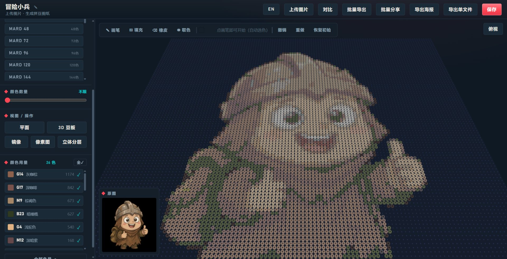

# 拼豆图纸生成器 · Perler Blueprint

上传一张图片，自动生成可实际拼搭的拼豆（Perler / Fuse Bead）图纸：2D 网格图纸 + Three.js 3D 豆板，量化到真实拼豆色板，还能把「图纸 + 源图 + 拼豆进度」保存成一份随身的单文件 HTML。

**在线使用**：<https://perler.phtbyte.com/> （无需登录，图片不上传服务器）



## 功能

- **上传图片 → 自动生成图纸**：内置 MARD / COCO / 漫漫 / Perler / Hama / Artkal 等 25 块真实色板共 3759 色，Lab 色彩空间最近色匹配
- **限色**：k-means 聚类（Lab 空间、k-means++ 初始化、固定种子保证同图同结果）把颜色压到指定数量，避免渐变区域出现脏色
- **2D 图纸**：镜像、格子色号标注（放大可见，按底色亮度自适应黑/白字）、高亮追踪、已完成勾选
- **3D 豆板**：Three.js 圆柱珠子 + 钉板底座，可切换「立体分层」——按图片明暗启发式分层堆叠
- **编辑模式**：画笔 / 填充 / 橡皮 / 取色 + 撤销重做；孤立散珠检测与一键清除（单颗珠实操很难固定）
- **导出**：
  - 海报 PNG / PDF（含色号对照表与用量统计）
  - 批量导出：全部标准规格合集 PDF + 配色统计 CSV（照着买豆子）
  - **单文件 HTML**：图纸、源图、拼豆进度全部写进一份 HTML，发微信 / 存网盘，打开就能继续拼
- **中 / EN 双语**，移动端手势适配（平移 / 捏合缩放 / 双击适配窗口），iOS 可通过系统分享存相册

## 单文件导出是什么意思

大多数工具导出的图纸数据锁在网站上。本项目的「导出单文件」会把整站页面连同你的图纸、源图、进度一起打包成一份 HTML 文件——它既是查看器也是存档，双击就能在任何电脑/手机浏览器打开继续用，不依赖原网站。适合分享给朋友或自己备份。

## 本地开发

```bash
npm install
npm run dev      # 开发（Vite HMR）
npm run build    # tsc + vite → dist/index.html（单文件产物）
```

技术栈：Vite + TypeScript + Three.js + jspdf + vite-plugin-singlefile。纯前端实现，无后端。

### 技术要点

- 色板匹配用 Lab + ΔE76（比 RGB 欧氏距离肉眼观感准很多）
- 限色用固定种子的 k-means 语义聚类，而不是简单按数量截断
- 3D 用 InstancedMesh 渲染珠子与钉板（大规格万级珠子保持流畅）
- 单文件自导出走 DOM 序列化（cloneNode 后改写存档节点、剥离外部脚本、补 doctype）——不能用正则替换 HTML 字符串，压缩后的 bundle 里就含有存档注入点的模板字符串，会误伤（踩过的坑，详见 `docs/AGENTS.md`）

## 目录结构

```
src/
  main.ts          编排根：装配 UI / 渲染器 / 持久化
  i18n.ts          中 / EN 双语字典与切换
  core/            栅格化、量化、色彩空间、深度启发式
  data/            真实色板（自动生成，勿手改）
  render/          2D 图纸 canvas / 3D 豆板 / 海报绘制
  ui/              上传、编辑器、批量导出、分享、对比等
  persist/         localStorage 存档 + 单文件自导出
```

## 反馈

量化选色跑偏、单文件打不开等问题，欢迎提 [issue](https://github.com/pht1991/perler-blueprint/issues)，最好附原图和所用规格。

## License

[MIT](LICENSE)
